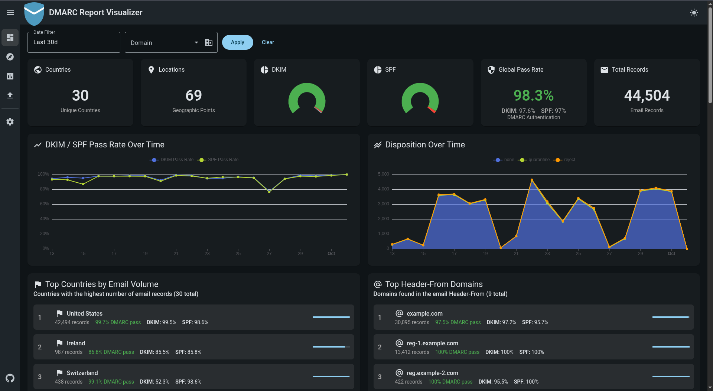
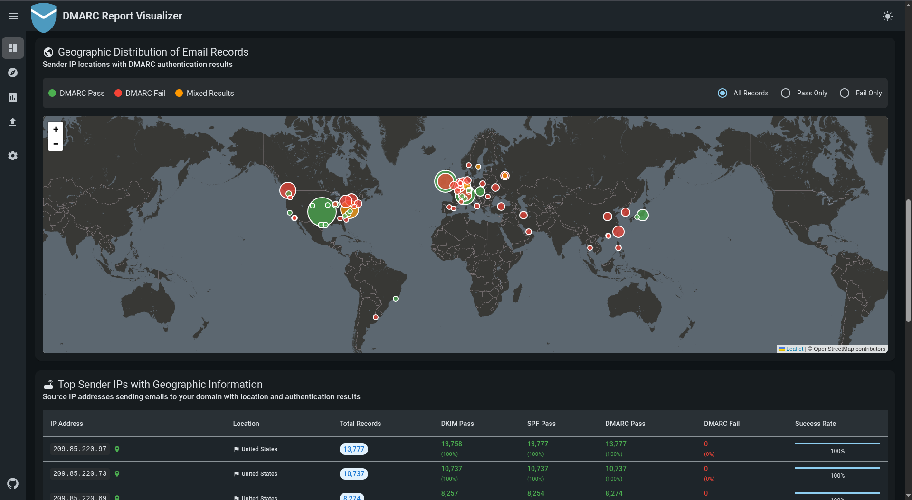
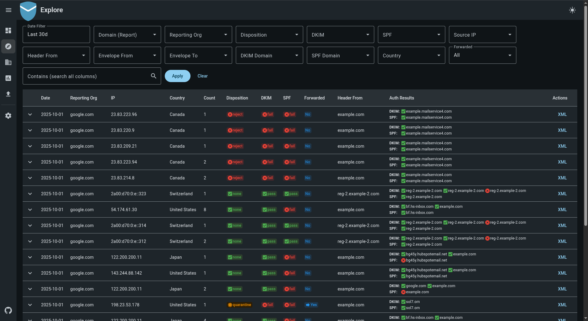
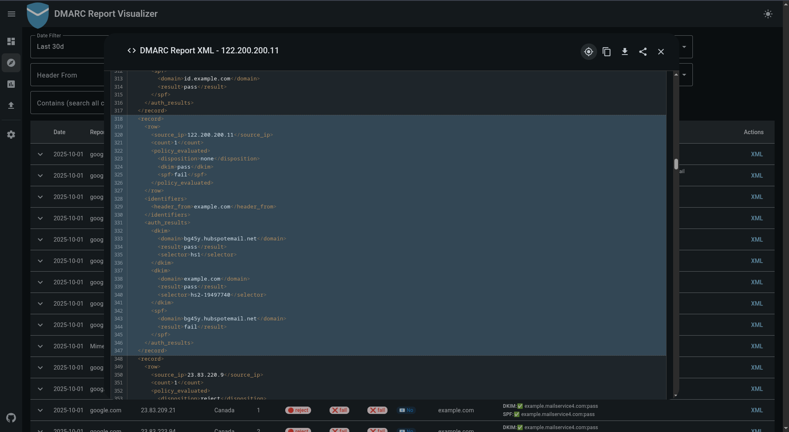

# DMARC Report Visualizer

  

A web application to visualize DMARC aggregate reports, built with NestJS and Angular.

Documentation: <https://samuelba.dev/dmarc-visualizer/docs/>

| Dashboard | Dashboard Map |
| --- | --- |
|  |  |

| Explore Reports | Report Raw XML |
| --- | --- |
|  |  |

## Quick start

1. Copy `.env.sample` to `.env`. Set `POSTGRES_PASSWORD`, `DATABASE_PASSWORD` (the same value), and `JWT_SECRET`. Generate each with `openssl rand -base64 48`.
2. `docker compose pull && docker compose up -d`
3. Open the UI and create the administrator account.

The UI is at `http://localhost` (or `FRONTEND_PORT`). Postgres and the API are not published. Put Traefik, Caddy, nginx, or a Cloudflare Tunnel in front when the site is public. The manual has a Compose file for each.

## Development

See [DEVELOPMENT.md](DEVELOPMENT.md). `npm run docs:preview -- <path-to-samuelba-website>` renders the manual locally.
