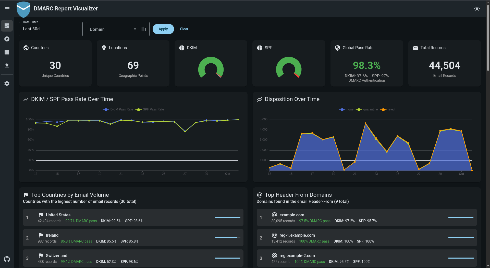
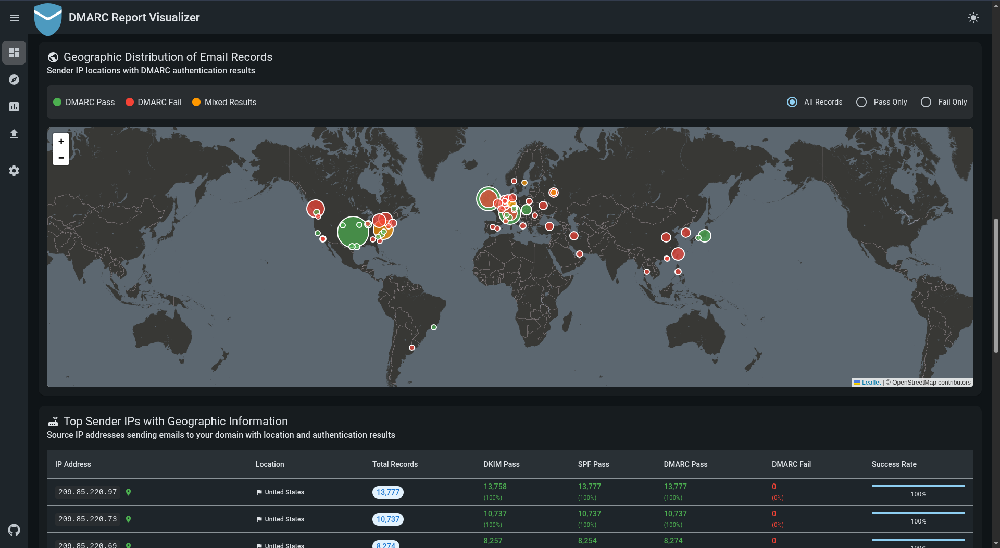

import { CardGrid, LinkCard } from '@astrojs/starlight/components';

DMARC Report Visualizer stores aggregate reports and shows where mail was accepted, rejected, or quarantined. The backend is NestJS, the UI is Angular, and the usual install is three Docker containers: Postgres, the API, and an nginx frontend.

```text
mailbox or upload
        |
        v
   backend :3000 ---- postgres
        ^
        |
 frontend nginx :80  (/api is proxied)
        ^
        |
 optional Traefik, Caddy, nginx, or a Cloudflare Tunnel
```




<CardGrid>
  <LinkCard title="Quick start" href="/dmarc-visualizer/docs/getting-started/quick-start/" description="Create .env, pull the images, and sign in." />
  <LinkCard title="Traefik" href="/dmarc-visualizer/docs/deployment/traefik/" description="HTTPS in front of the stack." />
  <LinkCard title="Configuration" href="/dmarc-visualizer/docs/reference/configuration/" description="Every environment variable." />
  <LinkCard title="Upgrading" href="/dmarc-visualizer/docs/deployment/upgrading/" description="Pull a new image without losing the database." />
</CardGrid>

## What you can do

- Charts, a world map, and a filterable record table. Open one report and read the raw XML.
- Upload a file, watch a directory, or pull reports from IMAP or the Gmail API.
- Check that an emailed report really came from the organization named in it (DKIM and ARC).
- Sign in with a password and optional TOTP, or with SAML.
- Give an assistant read-only access with a personal token ([MCP](/dmarc-visualizer/docs/usage/mcp/)). The server is off until you enable it.

Images are published as `ghcr.io/samuelba/dmarc-report-visualizer/dmarc-backend` and `dmarc-frontend`. See [Docker images](/dmarc-visualizer/docs/reference/docker-images/).
