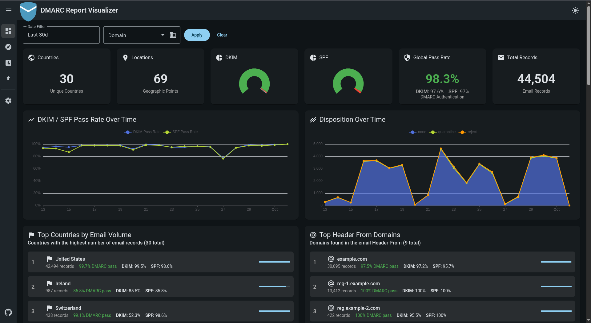
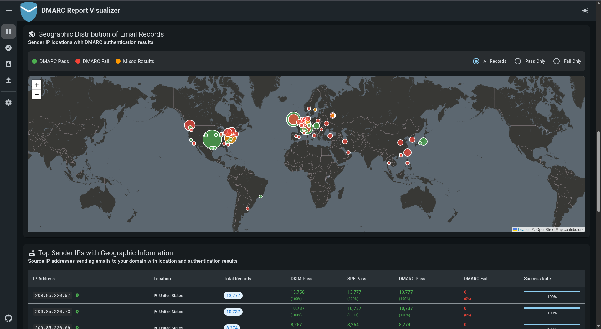

**Dashboard** (`/dashboard`) is the home page after sign-in. Filters are a date range and a domain. The domain filter applies only when exactly one domain is selected. With several selected, all domains are shown.

Cards: unique countries, DKIM and SPF pie charts, the global DMARC pass rate (with DKIM and SPF percents), and the total number of messages (the sum of record counts).

Charts: DKIM and SPF pass rate over time, and disposition over time. Tables: top countries and top header-from domains, each with record count and DMARC, DKIM, and SPF pass rates.

Below that, a world map, the top source IPs, email volume over time, and a "DMARC Insights & Recommendations" card.

Geolocation comes from [IP lookup](/dmarc-visualizer/docs/usage/ip-lookup/). Private addresses are not looked up.
