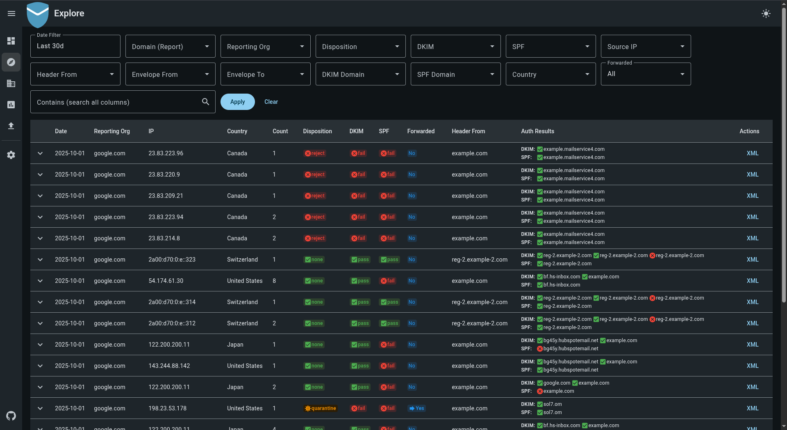
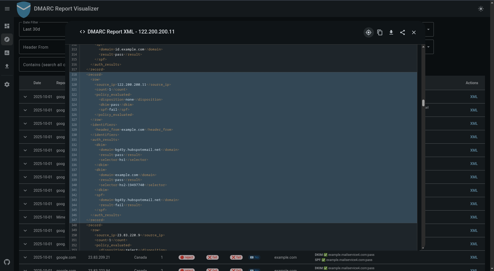

**Explore** (`/explore`) is one row per record. Filters: date, report domain, reporting organization, disposition (`none`, `quarantine`, `reject`), DKIM, SPF, source IP, header from, envelope from, envelope to, DKIM domain, SPF domain, country, forwarded (All, Yes, No, Unknown), and a contains search.

Columns: date, reporting organization, IP, count, disposition, DKIM, SPF, forwarded, country, ISP and organization, header from, and auth results. Columns are sortable. Page sizes are 10, 25, 50, and 100.

A row opens the record: DMARC status, identifiers, geolocation, published policy, policy override, forwarding, authentication results, and the raw XML.

**Reports** (`/reports`) is one row per aggregate report: domain, reporting organization, sender badge, report id, begin, and end. A row opens the XML. The sender badge opens delivery history. See [Sender authentication](/dmarc-visualizer/docs/ingestion/sender-authentication/).

